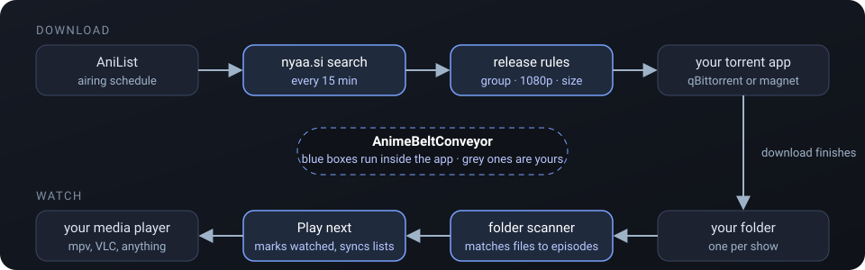
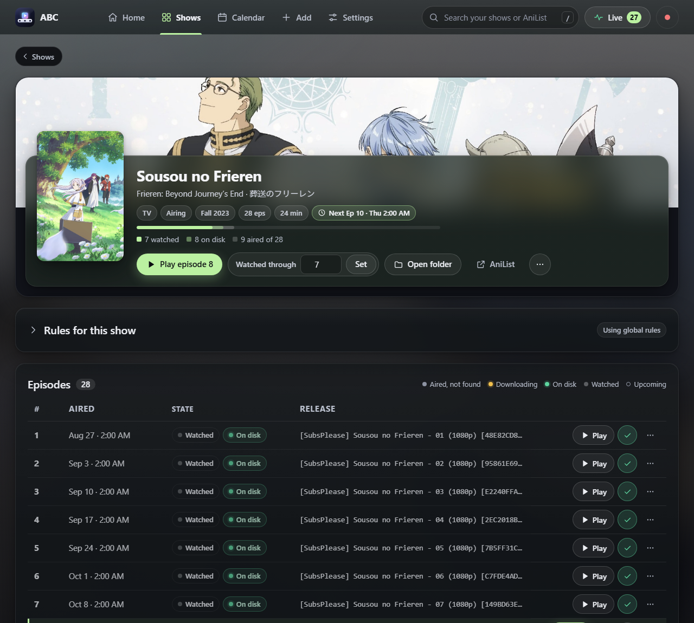
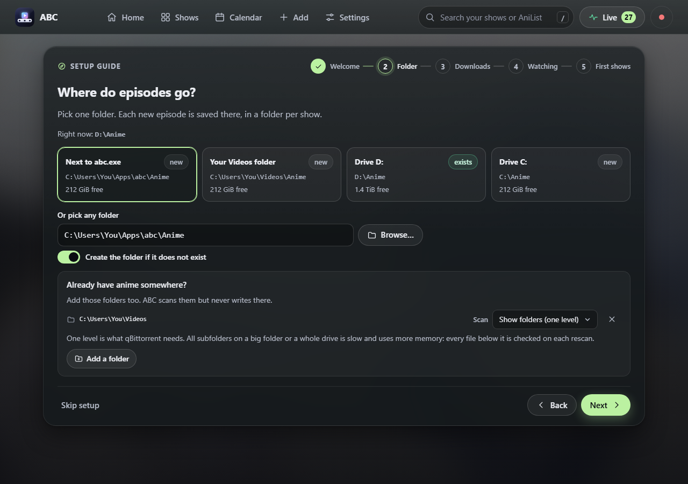
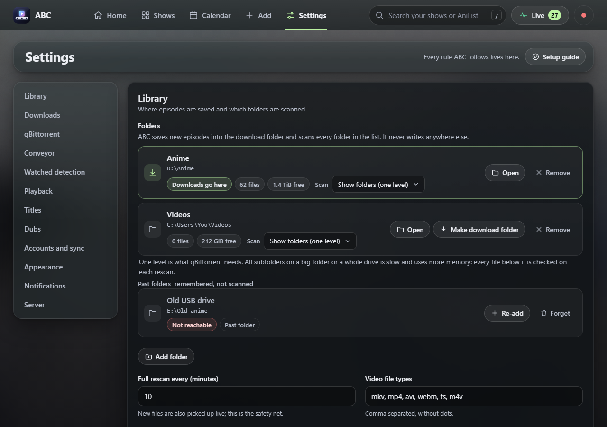
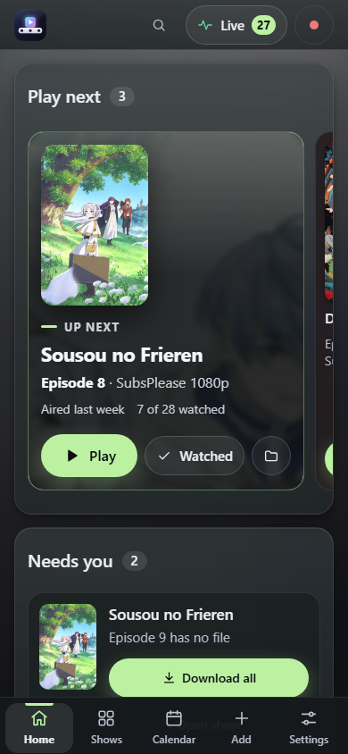

<p align="center">
  
</p>

<h1 align="center">AnimeBeltConveyor (ABC)</h1>

<p align="center">Weekly anime, delivered. You follow shows; new episodes land in your folder by themselves; you press Play.</p>

<p align="center"></p>


## What it does

- **Follows the schedule.** Pulls air times from AniList (and English dub times from animeschedule.net if you want them).
- **Finds the episode.** Searches nyaa.si for each new episode and picks one release by your rules: preferred groups in order, resolution, how long to wait for a preferred group, skip batches while airing, replace v1 with v2, minimum seeders, smallest file when otherwise equal, size cap.
- **Hands it to your torrent app.** qBittorrent through its Web API (save folder per show, progress, knows when it is done), or any other client through magnet links or a watch folder.
- **Knows what is on disk.** Watches your folders, matches files by name, so episodes you already have show as ready to play. Unplugged drives never lose their files.
- **Knows what you watched.** Player window open for half the runtime, a manual tick, "watched up to here", or an import from AniList or MyAnimeList. Optional push back to both.
- **Guard rails.** Only episodes from the last 14 days download by themselves; older ones wait for you. A torrent you remove in your client stays removed. Nothing downloads when the drive is nearly full. Every number above is a setting.
- **Sequels show both numbers: episode 3 (173).** AniList counts each season from 1, many release groups count the whole series. ABC follows AniList's prequel chain, so it finds both kinds of release.
- **Failed downloads clear themselves after 7 days or with one click.** A newer release for the episode also hides the old failure.

One Go binary, one SQLite file, a web UI at `http://127.0.0.1:7700`. No account, no cloud, no telemetry. It talks only to AniList, nyaa.si and your torrent app.

## Screens

| Show page | Setup guide |
|---|---|
|  |  |

| Settings | Phone |
|---|---|
|  |  |

## Run

Download `abc.exe` (or build it, below), double-click it. It opens the setup guide: pick a folder, pick how downloads happen, add a show. Five steps, every answer can be changed later in Settings.

```
abc                          # opens http://127.0.0.1:7700
abc --no-browser --port 7700 --data <dir>
```

- Data (database, log) lives in the per-user config folder (`%APPDATA%\abc` on Windows). Create a folder named `data` next to the exe to make it portable.
- qBittorrent: Tools › Options › Web UI › tick "Web User Interface (Remote control)", keep port 8080, tick "Bypass authentication for clients on localhost". The guide shows the same steps.
- Other clients: pick "magnet links" (the app registered for magnet links gets each one) or "watch folder" (ABC drops a .torrent file where your client looks). Set that client's download folder to the ABC download folder.

**Quiet start.** `abcw.exe` is the same program without a console window. Its log goes to `abc.log` in the data folder. Stop it with Settings › Server › Quit ABC. Double-clicking `abc.exe` or `abcw.exe` again while ABC runs just opens the running window.

## Build

```
go build -o abc ./cmd/abc        # any OS; Go 1.27.3+
./build.ps1  or  ./build.sh      # Windows: also embeds the icon (needs network once for rsrc)
go test ./...
```

The UI is plain HTML/CSS/JS in `web/`, embedded into the binary, no build step. Open `web/index.html?mock=1` in a browser to work on it without the server.

## Docs

- `SPEC.md` is the contract every package follows; `SPEC-v1.1.md` adds folders, downloader modes, the setup guide and the guard rails.
- Windows is where ABC is used daily. Linux and macOS build and run; player detection there is a planned feature.

## Licence

MIT.
